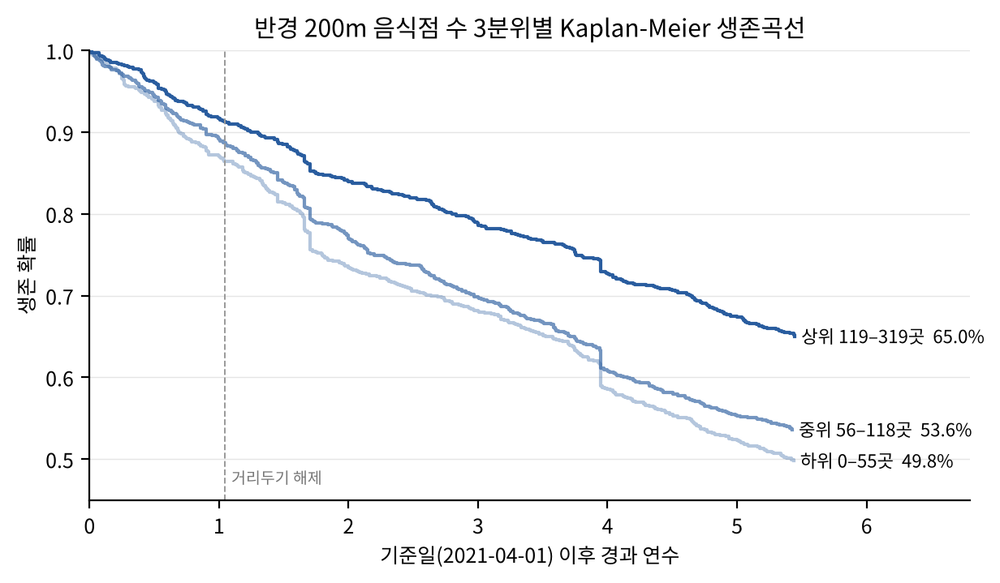
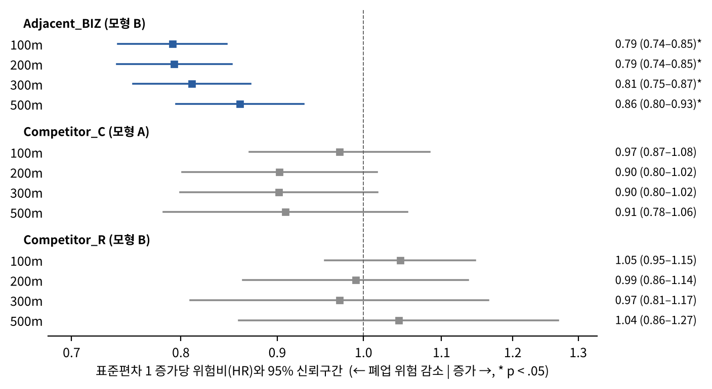

# 성동구 F&B 점포 생존 분석: 경쟁 네트워크 · 네이버 리뷰 · System Dynamics

서울시 성동구 일반음식점의 폐업 위험을 **반경 경쟁 변수와 경쟁 네트워크 구조**로 설명하고(Cox 비례위험모형),
추정 결과를 System Dynamics 정책 시뮬레이션에 연결하는 연구의 코드와 데이터입니다.

## 진행 현황 (2026-10-14 기준)

| 단계 | 내용 | 상태 |
|---|---|---|
| 데이터 구축 | 인허가·상권·매출·임대료 결합, 네이버 리뷰 매칭 | 완료 |
| 경쟁 변수 | 반경 100·200·300·500m Competitor_C / Adjacent_BIZ / Competitor_R | 완료 |
| 경쟁 네트워크 변수 | 반경별 가중 연결강도 · 매개중심성 · 군집계수 | 완료 |
| 생존분석 | Kaplan-Meier, 반경별 Cox 모형(H1–H3), 네트워크 Cox 모형(H4), 강건성 검토 | 완료 |
| 확장 분석 | 시간가변 공변량 모형, 코로나 기간 상호작용, 리뷰 결합 분석 | 예정 |
| System Dynamics | 추정 계수를 이식한 정책 시나리오 시뮬레이션 | 예정 |

## 연구 설계

- **기준 집단**: 2021-04-01(2021년 1분기 말) 영업 중인 성동구 일반음식점 **3,775개**
- **관찰 기간**: 2021-04-01 ~ 2026-09-12, 폐업 **1,656개(43.9%)**, 나머지는 우측 중도절단
- **연구 질문**
  - RQ1. 반경 기반 경쟁 변수를 통제한 뒤에도 경쟁 네트워크 구조가 폐업 위험을 추가로 설명하는가?
  - RQ2. 경쟁 범위(반경·상권 정의)는 어떻게 정해야 폐업 위험을 가장 잘 설명하는가?
  - RQ3. 추정한 생존 요인을 SD 모형에 넣으면 정책 시나리오별 상권은 어떻게 변하는가?
- **가설**
  - H1 (동종 경쟁): 같은 업태 이웃 수(C)와 비율(R)이 클수록 폐업 위험이 높다.
  - H2 (집적): 전체 음식점 수(BIZ)가 클수록 폐업 위험이 낮다.
  - H3 (공간 범위): H1·H2의 효과는 반경이 작을수록 크다.
  - H4 (네트워크): 반경 변수를 통제한 뒤에도 네트워크 지표가 폐업 위험을 추가로 설명한다.

## 주요 결과

모든 Cox 모형은 업력, 임대료 수준(low/mid/high), 상권 점포당 매출(log)과 결측 더미, 업태 더미를 통제했고,
상권 단위 군집 강건 표준오차(72개 군집)를 사용했습니다. 전체 수치는 [`outputs/results_summary.md`](outputs/results_summary.md)에 있습니다.

| 가설 | 결과 | 근거 |
|---|---|---|
| H1 동종 경쟁 | 기각 | C·R 모두 네 반경에서 유의하지 않음 (C의 HR은 1 미만) |
| H2 집적 | 지지 | 100m 안 음식점이 10곳 많을수록 폐업 위험 7.2% 감소 (HR 0.928, 95% CI 0.909–0.948) |
| H3 공간 범위 | 지지 | 표준편차 1 증가당 BIZ의 HR이 100m 0.79 → 500m 0.86으로 약해짐 |
| H4 네트워크 | 부분 지지 | 100m에서만 네트워크 지표의 증분 설명력이 유의 (LR χ²(3) = 10.7, p = .013). 가까운 동종 경쟁자에 촘촘히 둘러싸일수록(연결강도 1 SD당 HR 1.16) 폐업 위험 증가 |

- 반경 200m 음식점 수 상위 1/3 집단의 관찰 종료 시점 생존율은 65.0%로, 하위 1/3(49.8%)보다 15.2%p 높습니다(log-rank p < .001).
- 결론은 임대료 처리 방식(범주형·연속형·동 고정효과), 표본 제한(매출 관측 점포, 업종 미분류 제외, 일괄 폐업일 제외), 표준오차 보정 방식에 관계없이 유지됩니다.

<p align="center">
  
  
</p>

## 실행 방법

```bash
pip install -r code/requirements.txt

python code/build_features.py   # data/interim → data/final_dataset_with_reviews.csv (약 10초)
python code/cox_analysis.py     # data/final_dataset_with_reviews.csv → outputs/ (약 30초)
```

두 스크립트는 저장소에 포함된 `data/interim/restaurants_with_reviews_raw.csv`만으로 실행되며, 실행할 때마다 같은 결과를 냅니다.
그 앞 단계(원자료 전처리, 리뷰 수집)는 아래 [전체 파이프라인](#전체-파이프라인)을 참고하세요.

## 폴더 구성

```
code/
  build_features.py          분석용 데이터 생성: 열 이름 정리, 임대료 범주, 반경 경쟁 변수, 경쟁 네트워크 변수
  cox_analysis.py            Kaplan-Meier, Cox 모형(반경·네트워크), 강건성 검토, 그림·표·요약 저장
  naver_crawling_cohort.py   영업 점포를 한 곳씩 네이버 지도에서 검색 → 주소 검증 → 리뷰 수집
  make_hints.py              미매칭 점포의 place_id 힌트 생성
  combine_parts.py           나눠서 수집한 part 파일 합치기
  review_merge.py            리뷰 → 점포별 요약 변수 3개 → 데이터셋에 결합
  diagnose_search.py         검색 실패 원인 진단용
  requirements.txt
notebooks/
  preprocessing_submission.ipynb   인허가·상권·매출·임대료 원자료 전처리
data/
  interim/restaurants_with_reviews_raw.csv   전처리 + 리뷰 결합 결과 (build_features.py 입력)
  final_dataset_with_reviews.csv             분석용 최종 데이터 (점포 1행, 3,775행 × 51열)
  naver_match_results.csv                    인허가 점포 ↔ 네이버 매장 매칭 결과
outputs/
  results_summary.md                         전체 결과 요약 (표 형식)
  tables/                                    결과 표 (CSV)
  figures/                                   그림 (PNG)
```

## 전체 파이프라인

```
원자료 (서울 열린데이터광장, 성동구 임대료, Kakao 좌표)
  └─ notebooks/preprocessing_submission.ipynb   → final_restaurant_level_dataset.csv
       └─ code/naver_crawling_cohort.py → combine_parts.py → review_merge.py
            → data/interim/restaurants_with_reviews_raw.csv
                 └─ code/build_features.py       → data/final_dataset_with_reviews.csv
                      └─ code/cox_analysis.py     → outputs/
```

- 노트북은 원자료 폴더를 환경변수 `SEONGDONG_RAW_DIR`(기본값 `data/raw`)에서, Kakao API 키를 `KAKAO_REST_API_KEY`에서 읽습니다. 원자료와 API 키는 저장소에 포함하지 않습니다.
- 리뷰 수집은 `python -m playwright install chromium` 후 실행합니다.

## 변수 설명 (`data/final_dataset_with_reviews.csv`)

| 구분 | 변수 | 설명 |
|---|---|---|
| 식별 | `restaurant_id` | 인허가 관리번호 |
| | `store_name`, `address_jibun`, `longitude`, `latitude` | 상호명, 지번주소, 좌표(WGS84) |
| | `license_date`, `closure_date` | 인허가일, 폐업일 |
| 업태 | `category_code`, `category_name` | 서울시 서비스 업종 코드·이름 (8개). 결측 780곳은 분석에서 '미분류' |
| 상권 | `trdar_code`, `trdar_name` | 서울시 공식 상권 코드·이름 (상권 밖 점포는 결측) |
| | `area_sales_per_store` | 2021Q1 상권×업종 점포당 추정매출(원). 결측 808곳 |
| 임대료 | `dong`, `rent_median` | 법정동, 동별 평당전세가 중위값 (2021Q1) |
| | `rent_level` | 임대료 수준 low(<1,700) / mid(1,700–2,900) / high(≥2,900). 동 하나가 두 단계에 걸치지 않도록 동 값 사이의 큰 간격을 경계로 설정 |
| 생존 | `event` | 1 = 관찰 기간 중 폐업, 0 = 중도절단 |
| | `duration_days`, `observation_end` | 기준일부터 폐업일 또는 관찰 종료일까지의 일수, 그 종료일 |
| | `business_age_years` | 기준일 시점 업력(년) |
| 반경 경쟁 | `competitor_c_{r}m` | 반경 r m 안 같은 업태 이웃 수 (Competitor_C) |
| (r = 100, 200, 300, 500) | `adjacent_biz_{r}m` | 반경 r m 안 전체 음식점 수 (Adjacent_BIZ) |
| | `competitor_r_{r}m` | 같은 업태 비율 C / BIZ (Competitor_R) |
| 경쟁 네트워크 | `net_strength_{r}m` | 가중 연결강도: 같은 업태 이웃의 Σ(100 / 거리m). 100m 이웃 1곳 = 1 |
| | `net_betweenness_{r}m` | 매개중심성(정규화): 거리를 길이로 둔 최단경로 기준 |
| | `net_clustering_{r}m` | 군집계수: 같은 업태 이웃끼리도 서로 이웃인 비율 |
| 리뷰 (영업 점포만) | `naver_place_id`, `review_match_status`, `review_shared_place`, `has_review` | 네이버 매장 ID, 매칭 상태, 한 매장에 인허가 여러 건 여부, 리뷰 매칭 여부 |
| | `review_volume` | log(1 + 방문자 리뷰 총수): 온라인 노출도·수요 규모 |
| | `review_segment`, `review_tagged_n` | 성동구 평균 대비 특히 많은 손님층, 손님층 태그가 있는 리뷰 수 |
| | `review_revisit_share` | 재방문 리뷰 비율: 고객 충성도 |

변수 계산 기준
- 이웃은 기준일에 영업 중인 표본 점포이며, 자기 자신은 제외합니다.
- 거리는 EPSG:5186 평면좌표로 계산합니다.
- 경쟁 네트워크는 점포를 노드로, 반경 r 안의 같은 업태 점포 쌍을 엣지로 둡니다. 같은 건물(0m) 쌍은 거리를 10m로 봅니다.
- 원자료의 `rent_mean`, `duration_months`, `restaurants_all_300m`, `competitors_same_300m`은 최종 데이터에서 제외했습니다. 300m 변수는 위 기준으로 다시 계산했으며 기존 값과 92–97% 정확히 일치합니다(나머지는 경계의 ±1 차이).

## 결과 파일 (`outputs/`)

| 파일 | 내용 |
|---|---|
| `results_summary.md` | 전체 결과 요약 |
| `tables/variable_summary.csv` | 주요 변수 기술통계 |
| `tables/km_by_adjacent_biz_200m.csv` | 200m 음식점 수 3분위별 생존율, log-rank 검정 |
| `tables/cox_radius_models.csv` | 반경 × 모형(A: C+BIZ, B: R+BIZ)별 HR, 95% CI, p, C-index, 비례위험 검정 p, 1 SD당 HR |
| `tables/cox_full_300m_model_b.csv` | 300m 모형 B 전체 계수 (통제 변수 포함) |
| `tables/cox_network_models.csv` | 모형 C(모형 A + 네트워크 지표)의 HR, VIF, 우도비 검정, AIC, C-index |
| `tables/cox_robustness_300m.csv` | 강건성 검토 7가지 설정 |
| `figures/fig_km_by_adjacent_biz_200m.png` | Kaplan-Meier 생존곡선 |
| `figures/fig_forest_competition_by_radius.png` | 반경별 경쟁 변수 HR (1 SD당) |

HR 단위: C·BIZ는 10곳, R은 10%p, 네트워크 지표는 표준편차 1(매개중심성은 log 변환 후) 증가당입니다.

## 데이터 출처

| 구분 | 자료 | 출처 |
|---|---|---|
| 생존(종속) | 성동구 일반음식점 인허가 정보 | 서울 열린데이터광장 |
| 상권·매출 | 상권분석서비스 상권영역·점포·추정매출 (2021Q1) | 서울 열린데이터광장 |
| 임대료 | 성동구 상가임대료 (2021Q1) | 성동구 |
| 좌표 보완 | Kakao Local API | Kakao |
| 리뷰 | 네이버 지도 플레이스 방문자 리뷰 | 직접 수집 (2026.10) |

## 참고

- 하루 20곳 이상이 폐업 처리된 날이 4번(2022-09-13, 2022-11-29, 2022-12-15, 2025-03-12; 총 190곳) 있어 행정상 일괄 정리로 보고, 이 점포들을 제외한 강건성 검토를 함께 제시합니다.
- 리뷰 변수는 관찰 종료 시점의 영업 점포에만 있으므로 생존 모형에는 넣지 않고, 영업 점포 대상 확장 분석에만 사용합니다.
- `data/`에는 점포 단위 요약 변수만 포함됩니다.
